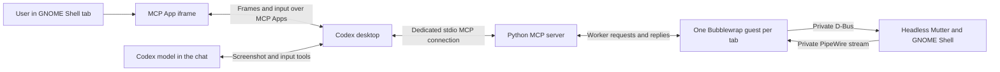

# Architecture

Each local chat has a dedicated stdio MCP server. It owns up to three isolated GNOME desktops, one per open GNOME Shell tab. The tab displays JPEG frames and sends input through Codex's MCP Apps bridge.

## Package and launch

| File | Responsibility |
| --- | --- |
| [`.agents/plugins/marketplace.json`](../.agents/plugins/marketplace.json) | Registers the local marketplace and locates the plugin directory. |
| [`plugin.json`](../gnome-shell/plugin.json), [`.codex-plugin/plugin.json`](../gnome-shell/.codex-plugin/plugin.json) | Portable and Codex-compatibility manifests for the same plugin name, display name, and version. |
| [`mcp.json`](../gnome-shell/mcp.json), [`.mcp.json`](../gnome-shell/.mcp.json) | Describe the same local launcher and working directory in both package formats. |
| [`launch-gnome-shell`](../gnome-shell/launch-gnome-shell), [`server.py`](../gnome-shell/server.py) | Start system Python and serve JSON-RPC over stdin and stdout. The server reads its version from the portable manifest. |
| [`desktop.html`](../gnome-shell/desktop.html), [`session.py`](../gnome-shell/session.py) | Implement the tab, visibility, sharing, session lifetime, and model access. |
| [`sandbox.py`](../gnome-shell/sandbox.py), [`desktop.py`](../gnome-shell/desktop.py), [`controls.py`](../gnome-shell/controls.py) | Launch and supervise the guest, capture its desktop, and validate and translate input. |

The `open_gnome_shell` tool declares the thread entrypoint and the `ui://gnome-shell/desktop.html` resource. Listing tools or reading the resource is enough for discovery. The worker starts after the loaded tab becomes visible and attaches. The server requires a stateful connection and rejects leased calls for a shared connection. [OpenAI thread entrypoint specification](https://github.com/openai/mcp-extensions/blob/main/docs/spec.md#thread-entrypoint), [MCP Apps overview](https://modelcontextprotocol.io/extensions/apps/overview)

## Tools

| Tool | Caller | Effect |
| --- | --- | --- |
| `open_gnome_shell` | Codex app | Opens the entrypoint tab. |
| `desktop_attach` | Tab | Registers or reconnects the view, and starts a desktop when visible. |
| `desktop_frame` | Tab | Renews the view and returns status and any new frame. |
| `desktop_view` | Tab | Retries startup, grants or revokes access, or closes the desktop. |
| `desktop_ui_input` | Tab | Sends a bounded batch of pointer, key, or scroll events. |
| `desktop_screenshot` | Model | Returns a JPEG and session ID for the currently shared desktop. |
| `desktop_input` | Model | Sends one supported action to the shared desktop with a matching session ID. |

The browser creates a random view token. It increments a counter on each transition between visible and hidden. Delayed requests from an earlier visibility state cannot make the tab active again or send input. A new share grant invalidates any previous grant in the same chat. Reconnecting, hiding, and closing the view revoke sharing. Each native restart gets a new session ID so old actions cannot target the replacement desktop.

## Screen and input

1. The MCP server starts a systemd user scope and a separate Bubblewrap guest with a temporary home and a cleared environment.
2. The worker starts its own D-Bus session bus, minimal system bus, PipeWire, and WirePlumber. It launches GNOME Shell in headless Wayland mode with one 1024×640 virtual monitor. The guest's settings select the US keyboard and a solid near-black background.
3. The worker creates a Mutter RemoteDesktop session and connects the monitor's ScreenCast stream to it. GStreamer reads the guest's PipeWire stream and encodes JPEGs at up to 8 frames per second. A sequence counter lets the tab skip identical frames.
4. The tab fits the image to its available space, maps pointer positions to the virtual monitor, and batches input. The worker validates keys against the guest's XKB map and sends events through Mutter. Releasing focus, hiding the view, or expiring input releases held keys and buttons.

## Session lifetime

| Transition | Behavior |
| --- | --- |
| Open or return to a visible tab | Start a fresh desktop or resume its existing guest. |
| Switch away | Keep the guest running, pause frame delivery, release held input, and revoke model access. |
| Receive a close request | Stop the tab's worker and discard its temporary home. Other tabs keep running. |
| Lose the view | Input access expires after 15 seconds. A missed close is reclaimed after about 25 seconds for a visible tab or 150 seconds for a hidden tab. |
| Guest exits or stops responding | Clean up the worker and show a retry action. A retry starts a fresh guest. |
| End the MCP connection | Close the owning chat's guests. Bubblewrap also terminates its desktop processes on parent loss. |

The server serializes each guest's worker requests and caps the number of pending MCP calls. Each scope has separate CPU, process, and memory limits. See [Security](../SECURITY.md) for the applicable boundaries.
